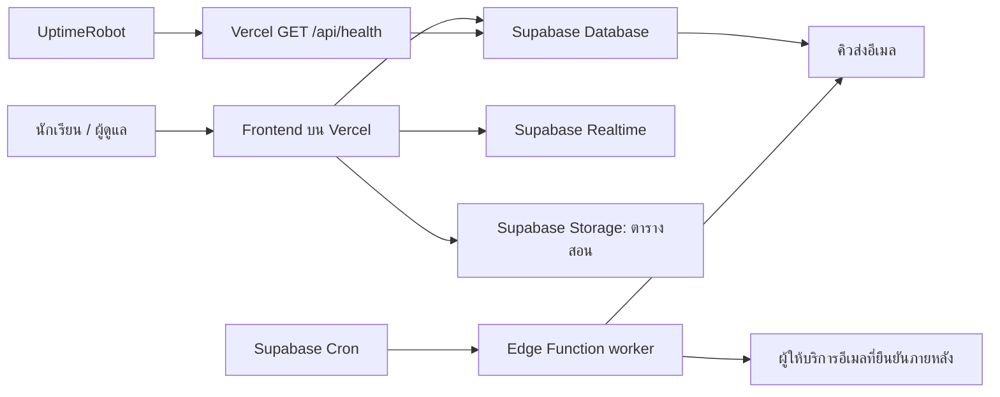

# HomeWork Station — Design, Backend และแผนย้ายระบบ

วันที่: 29 ตุลาคม 2569 (2026-10-29)  
สถานะ: **เอกสารออกแบบฉบับเสนอ ยังไม่ใช่ระบบที่พัฒนาหรือ deploy แล้ว**  
เจ้าของข้อกำหนด: ผู้ใช้ในแชตนี้  
โฟลเดอร์เวอร์ชันใหม่: `C:\Project\HomeWork Project\HomeWork Station`  
ต้นฉบับสำหรับอ้างอิง: `C:\Project\HomeWork Project\Old Git HomeWork\HomeWork-Station`  
Revision ต้นฉบับที่ตรวจ: `242ed48bdfcecb73de784bc996a4d5926b7d1b98`

## 1. เป้าหมายและขอบเขต

ทำเว็บภาษาไทยให้นักเรียนดูงานที่ต้องทำ เปลี่ยนสถานะงาน และเปิดตารางสอนได้สะดวกบนมือถือ ผู้ดูแลจัดการรายชื่อ วิชา งาน ตารางสอน และรายงานได้ ระบบใหม่ใช้ Supabase, Vercel และ Git Repo ใหม่ พร้อม endpoint สำหรับ UptimeRobot

เอกสารนี้กำหนด Design, Typography, หน้าจอ, กฎข้อมูล, Backend, การย้ายข้อมูล, การทดสอบ และลำดับทำงาน **การสร้างเอกสารนี้ไม่ได้อนุมัติการแก้โค้ด การย้ายข้อมูลจริง การสร้าง Repo หรือการเปิดใช้งานบริการ**

### 1.1 ข้อกำหนดที่ผู้ใช้ยืนยันแล้ว

- ระบบตั้งต้นอยู่ในโฟลเดอร์ Old และเป็นเว็บติดตามการบ้านนักเรียน
- ได้ตรวจซอร์สเดิมแล้ว พบ 24 ประเด็นที่ต้องแก้หรือพิจารณา
- เปลี่ยน Firebase Realtime Database เป็น Supabase/Postgres
- ใช้ Vercel และ Git Repo ใหม่
- เตรียมจุดสำหรับ UptimeRobot ตรวจระบบ
- เพิ่มที่เปิดตารางสอน โดยเริ่มจากรูปภาพได้ ผู้ใช้จะส่งรูปจริงภายหลัง
- ใช้แนวทาง frontend-design, supabase และ supabase-postgres-best-practices
- รอบนี้สร้างไฟล์แผน `.md` เท่านั้น
- ขอบเขตการตรวจและเอกสารรอบนี้ไม่รวมการประเมินความปลอดภัย เช่น RLS, API key exposure หรือช่องโหว่การเข้าสู่ระบบ

### 1.2 ข้อเสนอเริ่มต้นที่ยังไม่ได้ยืนยัน

| เรื่อง | ข้อเสนอสำหรับออกแบบ | ผลเมื่อผู้ใช้เลือกต่างออกไป |
|---|---|---|
| Frontend | Vite + TypeScript + DOM modules | เปลี่ยน framework ได้ก่อนเริ่มโค้ด |
| ห้องเรียน | ออกแบบ UI ให้เริ่มจากห้องเดียวเหมือนระบบเดิม | หลายห้อง/หลายปีต้องยืนยันโมเดลสมาชิกห้องก่อนสร้าง schema |
| การเข้าใช้ | คงแนวทางเลือกนักเรียนเป็นจุดตั้งต้นของ UX | หากต้องการบัญชีรายบุคคล ต้องออกแบบ Supabase Auth เพิ่ม |
| ข้อมูลเดิม | เสนอให้ย้ายและตรวจเทียบทั้งหมด | หากเริ่มใหม่ ให้กำหนดชัดว่าเก็บเฉพาะรายชื่อหรือรายการใด |
| งานเสริม | ไม่นับลดความครบของงานบังคับ | เปลี่ยนกฎก่อนเขียนสูตรรายงาน |
| เวลาครบกำหนด | งานแบบวันที่ยังไม่เกินกำหนดตลอดวันนั้นในเวลาไทย | ถ้าต้องระบุเวลา เพิ่ม due_at และแก้ UI ให้ตรงกัน |
| ตารางสอน | รูปภาพหลักหนึ่งรูปต่อห้อง/ภาคเรียน พร้อมประวัติรูป | ถ้ามีหลายชุด ให้เพิ่มตัวเลือกชุดภาพโดยไม่ทำตารางแก้ไขรายคาบทันที |
| อีเมล | รักษาความสามารถเดิม แต่เปลี่ยนเป็นงานส่งที่ติดตามผลได้ | ผู้ใช้เลือกปิดฟีเจอร์นี้ได้ก่อนพัฒนา |

ข้อเสนอเหล่านี้มีไว้ทำให้แผนตรวจทานได้ ไม่ใช่ข้อสรุปแทนผู้ใช้

### 1.3 สิ่งที่ยังไม่อยู่ในรุ่นแรก

- OCR หรืออ่านคาบเรียนจากรูปโดยอัตโนมัติ
- ตารางลากวางรายคาบ ระบบจัดตารางสอน หรือแจ้งเตือนก่อนเข้าเรียน
- ระบบให้คะแนน ส่งไฟล์การบ้าน หรือ LMS เต็มรูปแบบ
- แชตในห้องเรียน ระบบแต้ม เหรียญ หรืออันดับแข่งขันแบบใหม่
- Offline editing และการซิงก์ข้อมูลที่แก้ระหว่างออฟไลน์
- Dark mode และ PWA จนกว่า flow หลักจะผ่านการทดสอบ
- การเปลี่ยนข้อมูลจริงหรือยกเลิกระบบเดิมก่อนทดสอบย้ายข้อมูลสำเร็จ

## 2. แนวคิด Design

แนวทาง: **สมุดงานประจำห้องเรียนที่อ่านง่ายและเปิดดูได้เร็ว**

สิ่งที่ต้องเด่นที่สุดคือ “เหลืองานอะไร และต้องทำเมื่อไร” ตามด้วยปุ่มเปิดตารางสอน ใช้พื้นผิวเรียบ เนื้อหาชิดซ้าย ช่องไฟชัด และตัวอักษรภาษาไทยที่อ่านต่อเนื่องได้ดี

หลักการ:

1. เปิดหน้าแล้วเห็นงานและวันครบกำหนดก่อนกราฟหรือสถิติใหญ่
2. ใช้สีเพื่อสถานะและการกระทำ ไม่ใช้สีรุ้งตกแต่งแต่ละวิชา
3. แสดงชื่อวิชา ชื่องาน วันครบกำหนด และสถานะด้วยลำดับเดิมทุกใบงาน
4. ชื่อห้องและภาคเรียนมาจากข้อมูล ไม่ hardcode ม.5/2 กระจายตามไฟล์
5. ไม่ใช้ emoji เป็นตัวระบุสถานะในฐานข้อมูล ส่วน UI ใช้ไอคอนพร้อมข้อความ
6. ไม่สร้างตารางสอนหรือรายชื่อนักเรียนตัวอย่างให้ดูเหมือนข้อมูลจริง

### 2.1 ทบทวนแนวคิดก่อนทำหน้าจอ

- Dashboard แบบการ์ดตัวเลขจำนวนมากไม่เหมาะเป็นหน้าแรกของนักเรียน จึงให้หน้ารายการงานเป็นหน้าหลัก
- งด gradient, เงาหนัก และ animation เปิดเข้าทีละการ์ด เพราะแย่งความสนใจจากชื่องาน
- ตารางสอนใช้ภาพเต็มสัดส่วนเป็นเนื้อหาหลักของหน้านั้น ไม่ครอปลงการ์ดตกแต่ง
- งานที่ส่งแล้วใช้ลำดับภาพที่สงบลง แต่ยังอ่านชื่อและวันที่ได้ ไม่ลด opacity ทั้งใบ
- สถานะเกินกำหนดต้องมีข้อความ ไม่พึ่งสีแดงเพียงอย่างเดียว

## 3. Font และ Typography

### 3.1 Font หลัก

ใช้ **IBM Plex Sans Thai Looped** เป็นข้อเสนอหลักทั้งภาษาไทยและตัวอักษรละติน ใช้ตระกูลเดียวเพื่อลดความไม่สม่ำเสมอของความสูงบรรทัดและจำนวนไฟล์ฟอนต์ ฟอนต์มีรูปแบบไทยมีหัว เหมาะกับเนื้อหาการเรียนที่ต้องอ่านหลายบรรทัด ดูตัวตระกูลจาก [IBM Typeface](https://www.ibm.com/design/language/typography/typeface/)

Fallback: `"IBM Plex Sans Thai Looped", "Sarabun", Tahoma, sans-serif`

- ใช้น้ำหนัก 400 สำหรับเนื้อหา, 500 สำหรับป้ายกำกับ, 600 สำหรับชื่อและปุ่มหลัก, 700 เฉพาะหัวข้อ
- ใช้ไฟล์ WOFF2 ที่มากับแหล่งฟอนต์หรือ build pipeline ที่ตรวจแล้ว พร้อมเก็บ license ของฟอนต์
- เก็บฟอนต์ภายใน asset ของเว็บ ใช้ `font-display: swap`
- ไม่ preload ทุกน้ำหนัก เริ่มจากน้ำหนักเนื้อหาที่จำเป็นต่อหน้าจอแรก และตรวจว่าไม่โหลดไฟล์ซ้ำ
- ทดสอบข้อความมีสระ/วรรณยุกต์สูง เช่น “สิ่งที่ต้องส่งวันนี้” และ “กำลังทำแบบฝึกหัด” ว่าไม่ถูกตัด
- ไม่ใช้ letter-spacing กว้างกับข้อความภาษาไทย ไม่ใช้ตัวหนาจำลองเมื่อไม่มีไฟล์น้ำหนักนั้น

### 3.2 ขนาดตัวอักษร

| บทบาท | มือถือ | Desktop | น้ำหนัก | Line height |
|---|---:|---:|---:|---:|
| ชื่อหน้า | 24px | 30px | 600 | 1.4 |
| หัวข้อส่วน | 20px | 22px | 600 | 1.45 |
| ชื่องาน | 17px | 18px | 600 | 1.55 |
| เนื้อหา/รายละเอียด | 16px | 16px | 400 | 1.7 |
| ปุ่ม/ช่องกรอก | 16px | 16px | 500–600 | 1.5 |
| ชื่อวิชา/metadata | 14px | 14px | 500 | 1.6 |
| คำอธิบายเสริม | 13px | 13px | 400 | 1.6 |
| ข้อความใต้เมนูล่าง | 12px | ไม่ใช้ | 500 | 1.4 |

กฎใช้งาน:

- ข้อมูลที่จำเป็นต่อการทำงานไม่ใช้ขนาด 9–11px แบบระบบเดิม
- รายละเอียดงานมีความกว้างประมาณ 65–75 ตัวอักษรต่อบรรทัดบน desktop โดยตรวจความอ่านง่ายจากข้อความไทยจริงอีกครั้ง
- ตัวเลขเปอร์เซ็นต์และเวลาใช้ `font-variant-numeric: tabular-nums` เมื่อฟอนต์รองรับ
- ขยายตัวอักษร 200% แล้วยังเข้าถึงปุ่มและข้อมูลสำคัญได้
- ชื่อนักเรียนในรายการยาวได้ 2 บรรทัด ชื่อเต็มในหน้ารายละเอียดไม่ถูกซ่อนด้วย ellipsis เพียงอย่างเดียว

## 4. สี ระยะห่าง และรูปทรง

### 4.1 สีพื้นฐาน

| Token | ค่า | การใช้งาน |
|---|---|---|
| background | `#F6F8FB` | พื้นหลังหน้า |
| surface | `#FFFFFF` | เนื้อหา ฟอร์ม และแผงรายละเอียด |
| text | `#17233B` | ข้อความหลัก |
| text-muted | `#526178` | วันที่ คำอธิบายรอง และ label |
| primary | `#2456C7` | ปุ่มหลัก ลิงก์ สถานะที่เลือก |
| border | `#CBD5E1` | เส้นขอบทั่วไป |

### 4.2 สีเชิงความหมาย

| สถานะ | ตัวอักษร | พื้นหลัง | ข้อความกำกับ |
|---|---|---|---|
| ยังไม่เริ่ม | `#475569` | `#F1F5F9` | ยังไม่เริ่ม |
| กำลังทำ | `#854D0E` | `#FEF9C3` | กำลังทำ |
| ทำเสร็จแล้ว | `#166534` | `#DCFCE7` | ทำเสร็จแล้ว |
| ส่งแล้ว | `#1D4ED8` | `#DBEAFE` | ส่งแล้ว |
| เกินกำหนด/ผิดพลาด | `#B42318` | `#FEF3F2` | เกินกำหนด หรือข้อความข้อผิดพลาด |

ค่าเหล่านี้เป็น token ตั้งต้น ต้องตรวจ contrast ของทุกคู่ที่ใช้จริงให้ผ่านอย่างน้อย 4.5:1 สำหรับข้อความขนาดปกติ สี border ทั่วไปไม่ใช้แทนเส้น focus หรือขอบ control ที่จำเป็นต้องเห็นชัด

### 4.3 Layout tokens

- ระยะห่าง: 4, 8, 12, 16, 24, 32, 48px
- Padding หน้า: มือถือ 16px, tablet 24px, desktop 32px
- Radius: input/button 10px, แผงงาน 14px, dialog 18px
- ความสูง control หลักอย่างน้อย 44px; input/select 48px
- ไอคอน 20–24px ใช้ SVG ชุดเดียวกัน มีข้อความหรือ accessible name
- เงาใช้เฉพาะแผงลอย เช่น dialog และ dropdown ไม่ใส่ทุกแถวข้อมูล
- Focus ring: หนา 3px, offset 2px, เห็นชัดบนพื้นขาวและพื้นเลือก
- Motion ตอบสนองการกดประมาณ 120–180ms; เคารพ `prefers-reduced-motion`

## 5. โครงสร้างหน้าและ Navigation

### 5.1 หน้าหลัก

| หน้า | หน้าที่ | เส้นทางที่เสนอ |
|---|---|---|
| งาน | เลือกนักเรียน ดูรายการ และเปลี่ยนสถานะ | `/?view=tasks&student=<id>` |
| ตารางสอน | เปิดรูปตารางสอนของห้องปัจจุบัน | `/?view=timetable` |
| รายชื่อ | ค้นหานักเรียนและดูความคืบหน้า | `/?view=students` |
| ภาพรวม | สรุปงานบังคับที่ค้างและความคืบหน้าของห้อง | `/?view=overview` |
| จัดการ | รายชื่อ วิชา งาน ตารางสอน นำเข้า/ส่งออก และสถานะอีเมล | `/?view=manage` |

ใช้ query parameters ก่อนเพื่อให้เปิดลิงก์ตรงและ browser back/forward ได้ โดยไม่ต้องเพิ่ม SPA rewrite กว้าง ๆ ที่อาจทับ `/api/health` ค่า ID ที่ไม่มีอยู่ต้องแสดงสถานะรายการหายและล้างการเลือกได้

### 5.2 Desktop

แถบบนมีชื่อเว็บ ชื่อห้อง/ภาคเรียน และเมนู งาน / ตารางสอน / ภาพรวม / จัดการ หน้างานใช้รายชื่อด้านซ้ายกว้างประมาณ 280–320px กับเนื้อหางานด้านขวา ขยายพื้นที่เนื้อหาได้ถึงประมาณ 1280px

```text
+----------------------------------------------------------------+
| HomeWork Station   [ห้อง/ภาคเรียน]   งาน ตารางสอน ภาพรวม จัดการ |
+------------------------+---------------------------------------+
| ค้นหานักเรียน          | ชื่อนักเรียน            งานบังคับครบ x/y |
| ตัวกรองรายชื่อ         | [ยังไม่ครบ] [ทั้งหมด] [เสร็จแล้ว]       |
|                        | [วิชา] [ประเภท] [ช่วงกำหนดส่ง]          |
| เลขที่ / ชื่อ / x/y    |                                       |
| เลขที่ / ชื่อ / x/y    | งานเกินกำหนด                           |
|                        | วิชา • วันครบกำหนด                     |
|                        | ชื่องาน / รายละเอียด / เอกสารแนบ       |
|                        | [เปลี่ยนสถานะ]                         |
+------------------------+---------------------------------------+
```

### 5.3 มือถือ

เมนูล่าง 4 รายการ: **งาน / ตารางสอน / ภาพรวม / เพิ่มเติม** หน้าเพิ่มเติมรวมรายชื่อและทางเข้าจัดการ เพื่อไม่ให้มีปุ่มเล็ก 5–6 ปุ่มในแถบเดียว

```text
+----------------------------------+
| HomeWork Station     [ห้องเรียน] |
| นักเรียนที่เลือก        [เปลี่ยน] |
+----------------------------------+
| งานบังคับครบ x/y                 |
| [ยังไม่ครบ] [ทั้งหมด] [เสร็จแล้ว] |
| [วิชา v] [ประเภท v]              |
|                                  |
| งานเกินกำหนด                     |
| [ใบงานพร้อมปุ่มสถานะขนาดแตะง่าย] |
|                                  |
+----------------------------------+
| งาน | ตารางสอน | ภาพรวม | เพิ่มเติม |
+----------------------------------+
```

หากยังไม่เลือกนักเรียน ให้แสดงตัวเลือกพร้อมข้อความ “เลือกนักเรียนเพื่อดูงานของคุณ” และยังเปิดตารางสอนของห้องได้ ตารางสอนไม่ผูกกับการเลือกนักเรียน

### 5.4 Breakpoints

- ต่ำกว่า 768px: หนึ่งคอลัมน์ เมนูล่าง ตัวเลือกนักเรียนแบบ panel ที่เลื่อนได้
- 768–1023px: หนึ่งคอลัมน์เป็นค่าเริ่มต้น พร้อมตัวเลือกนักเรียนแบบ drawer เพื่อไม่บีบชื่องาน
- ตั้งแต่ 1024px: รายชื่อและงานสองคอลัมน์
- ใช้ CSS media queries ควบคุม layout ไม่เขียน inline `display` ค้างข้าม breakpoint
- ใช้ `100dvh` เฉพาะส่วนที่ต้องเติม viewport; เนื้อหาหลักเลื่อนตามธรรมชาติ
- เว้นพื้นที่เมนูล่างตามความสูงจริงและ `env(safe-area-inset-bottom)`
- Dialog ใช้ความสูงไม่เกิน `calc(100dvh - 32px)` มีส่วนเนื้อหาเลื่อนได้ และปุ่มหลักเข้าถึงได้เมื่อเปิดคีย์บอร์ด

## 6. หน้างานและกฎการแสดงผล

### 6.1 โครงสร้างใบงาน

1. วิชาและประเภทงาน
2. ชื่องาน
3. วันครบกำหนดที่อ่านเป็นภาษาไทย เช่น “ครบกำหนด 29 ต.ค. 2569”
4. ป้าย “วันนี้”, “อีก 2 วัน” หรือ “เกินกำหนด 1 วัน”
5. รายละเอียดที่รักษาการขึ้นบรรทัด ไม่ขยายทุกใบด้วยข้อความยาวมากทันที
6. ลิงก์แนบที่ใช้คำชัดเจน “เปิดเอกสารแนบ”
7. สถานะปัจจุบันและ control เปลี่ยนสถานะ

มือถือใช้ปุ่ม “สถานะ: กำลังทำ” เปิดตัวเลือกที่มีพื้นที่แตะอย่างน้อย 44px หรือ radio group ที่ขึ้นบรรทัดได้ ไม่ย่อทั้ง 4 สถานะลงเป็นตัวอักษร 9px

### 6.2 การจัดกลุ่มและเรียง

- ยังไม่ครบ: เกินกำหนด → วันนี้ → ภายใน 3 วัน → ภายใน 7 วัน → หลังจากนั้น
- ภายในกลุ่มเรียง `due_date` แล้ว `id` เพื่อให้ลำดับคงที่
- งานสำเร็จแล้วไม่ถูกติดป้ายว่าเป็นงานค้าง แม้วันที่ผ่านไปแล้ว
- งานเสริมมีป้ายชัดเจนและไม่ถูกแทรกเป็นงานบังคับที่ทำให้ผู้ใช้ดูเหมือนส่งไม่ครบ
- หากไม่มีงานบังคับ ให้แสดง “ยังไม่มีงานบังคับ” แทนข้อความ 0% ที่สื่อว่าทำไม่สำเร็จ

### 6.3 กฎความสำเร็จที่เสนอ

| task_type | ถือว่าสำเร็จเมื่อ | นับในงานบังคับ |
|---|---|---|
| `submit` — ต้องส่ง | `submitted` | ใช่ |
| `do` — ต้องทำ | `done` หรือ `submitted` | ใช่ |
| `optional` — ไม่ทำก็ได้ | `done` หรือ `submitted` | ไม่ |

เปอร์เซ็นต์หลัก = งานบังคับที่สำเร็จ / งานบังคับที่มอบหมายทั้งหมด งานเสริมแสดงแยกเป็นจำนวน ไม่ดึงเปอร์เซ็นต์ลง

- ไม่มี submission หมายถึง `not_started` โดยไม่ต้องสร้างแถวให้ทุกคู่ล่วงหน้า
- ใช้ฟังก์ชันเดียวกันสำหรับ sidebar, หัวนักเรียน, ภาพรวม และ CSV
- Progress หลักนับงานบังคับทั้งขอบเขตห้อง/นักเรียน ไม่เปลี่ยนตาม filter หรือหน้าของ pagination ที่กำลังเปิด การโหลดรายการ 25 งานต้องไม่ทำให้ตัวหารเหลือเฉพาะ 25 งานนั้น
- ใช้ aggregate ของฐานข้อมูลสำหรับสรุปขอบเขตใหญ่; `calculateProgress()` ฝั่ง client ใช้เฉพาะเมื่อมีข้อมูลครบทั้งขอบเขตที่คำนวณแล้ว ไม่ป้อนแค่ page ปัจจุบัน
- อัปเดตสรุปก่อนตัดสินว่ารายการหลังกรองว่างหรือไม่
- ขณะกำลังบันทึกแสดงสถานะใน control ของงานนั้น ไม่ล็อกทั้งหน้า
- ค่า UI ถือว่ายืนยันแล้วเมื่อ server ตอบสำเร็จ หากใช้ optimistic UI ต้อง rollback ได้และไม่แสดงว่าสำเร็จถาวรตั้งแต่ก่อนตอบ

### 6.4 วันที่และเวลา

- `assigned_on` และ `due_date` เป็น Postgres `date` เมื่อไม่มีเวลาเฉพาะ
- `created_at`, `updated_at`, `completed_at` เป็น `timestamptz`
- เปรียบเทียบวันด้วยปฏิทินเขตเวลา `Asia/Bangkok` ไม่ใช้ `new Date('YYYY-MM-DD')` แล้วลบกับเวลาปัจจุบัน
- เกินกำหนดเมื่อ `due_date < todayInBangkok`; งานครบกำหนดวันนี้ยังไม่เกินกำหนด
- สรุปสัปดาห์ใช้จันทร์–อาทิตย์จาก `assigned_on`
- วันที่มอบหมายเริ่มต้นเป็นวันนี้ แต่ผู้ใช้แก้ได้; หน้าแก้ไขต้องมีช่องนี้
- เมื่อต้องพักหน้าไว้ข้ามเที่ยงคืน ให้คำนวณใหม่ และคำนวณซ้ำเมื่อกลับมาที่แท็บ
- แสดงปี พ.ศ. ใน UI แต่เก็บวันที่มาตรฐาน ค.ศ. ในฐานข้อมูลและเอกสารนำเข้า

## 7. ตารางสอนแบบรูปภาพ

### 7.1 สิ่งที่ทำได้ในรุ่นแรก

- เมนู “ตารางสอน” เปิดได้ทั้งก่อนและหลังเลือกนักเรียน
- แสดงชื่อห้อง ภาคเรียน ชื่อตาราง และวันที่อัปเดต
- แสดงรูปจริงเต็มสัดส่วน ใช้ `object-fit: contain` ไม่ crop
- ปุ่ม “ขยายดู”, “พอดีหน้าจอ”, “ขนาด 100%”, “ซูมเข้า”, “ซูมออก” และ “ดาวน์โหลดรูปต้นฉบับ”
- Viewer ซูมด้วยปุ่มได้โดยไม่บังคับใช้ gesture; เมื่อซูมแล้วเลื่อนดูได้ทั้งสองแกน
- รองรับ browser zoom และการเลื่อนสัมผัส ไม่ปิดการซูมของเบราว์เซอร์
- รุ่นแรกเสนอช่วงซูม 50–300% และมีปุ่ม reset; ตรวจอีกครั้งเมื่อได้ขนาดรูปจริง
- มือถือเปิด viewer เต็มพื้นที่ใช้งาน มีปุ่มปิดที่ไม่หลุดใต้ safe area
- จดจำสถานะงานและตำแหน่งเลื่อนเมื่อกลับจากตารางสอน

```text
+--------------------------------------+
| ตารางสอน              ห้อง / ภาคเรียน |
| ชื่อตาราง • อัปเดตวันที่ ...          |
| [ขยายดู] [ดาวน์โหลดรูป]               |
|                                      |
|     ภาพตารางสอนจริงทั้งภาพ            |
|     ไม่ครอป / ไม่สร้างข้อมูลแทน       |
|                                      |
| ข้อความประกอบจากผู้ดูแล (ถ้ามี)       |
+--------------------------------------+
```

### 7.2 สถานะก่อนมีรูป

ข้อความหลัก: **“ยังไม่ได้เพิ่มตารางสอน”**  
ข้อความรอง: “เมื่อเพิ่มรูปตารางสอนแล้ว จะเปิดดูและขยายได้จากหน้านี้”

- ไม่สร้างตารางวันจันทร์–ศุกร์หรือชื่อวิชาสมมุติ
- ผู้ดูแลเห็นปุ่ม “เพิ่มรูปตารางสอน”; นักเรียนเห็นสถานะว่างตามปกติ
- ถ้า metadata มีรูปแต่โหลดไฟล์ไม่ได้ ให้แสดง “โหลดรูปตารางสอนไม่สำเร็จ” พร้อม “ลองใหม่” ไม่เปลี่ยนเป็นสถานะไม่มีรูป

### 7.3 Flow ผู้ดูแล

1. เลือก PNG, JPEG หรือ WebP; ขนาดเริ่มต้นเสนอไม่เกิน 6MB เพื่อให้ upload แบบมาตรฐานเรียบง่ายและลองใหม่ได้เร็ว
2. แสดงภาพตัวอย่าง ชื่อไฟล์ ขนาดภาพ และขนาดไฟล์ก่อนส่ง
3. กรอกชื่อตาราง ห้อง/ภาคเรียน และข้อความประกอบที่มีจริง
4. Upload ไป Supabase Storage ด้วย object path ใหม่ เช่น `classroom-id/image-id/original.png`
5. เมื่อ upload สำเร็จ จึงบันทึก metadata และเปลี่ยนรูป active ใน transaction
6. รูปเดิมยังเป็น active หาก upload หรือบันทึก metadata ล้มเหลว
7. ไม่เขียนทับ path รูปเก่า เพื่อลดปัญหาผู้ใช้ยังเห็นรูปเก่าจาก cache
8. หาก upload สำเร็จแต่ metadata ไม่สำเร็จ ให้รายงานและเก็บรายการไฟล์รอ cleanup; ห้ามลบรูปเดิมที่ยังใช้งานอยู่

Supabase แนะนำ standard upload สำหรับไฟล์ขนาดเล็ก และแนะนำ path ใหม่เมื่อต้องเปลี่ยนภาพเพื่อหลีกเลี่ยง cache เก่า ดู [Storage uploads](https://supabase.com/docs/guides/storage/uploads/standard-uploads)

### 7.4 คุณภาพภาพและการเข้าถึง

- รอรูปจริงจากผู้ใช้ก่อนกำหนดการปรับภาพ ไม่ตัดขอบตารางหรือบีบอักษรจนอ่านไม่ได้
- เก็บต้นฉบับเสมอ รูป preview ที่บีบอัดเป็นไฟล์เพิ่ม ไม่แทนต้นฉบับ
- บันทึก width/height เพื่อกันหน้าเลื่อนกระโดดขณะโหลด
- ตรวจรูปแนวนอน แนวตั้ง ภาพใหญ่มาก และข้อความขนาดเล็กในจอมือถือ
- ใช้ alt บอกว่าเป็นตารางสอนห้องใด ไม่อ้างว่า alt สั้น ๆ ทดแทนเนื้อหารายคาบทั้งหมด
- ถ้าต้องการให้อ่านรายละเอียดรายคาบด้วย screen reader ต้องเพิ่มข้อความหรือตาราง HTML จากข้อมูลจริงภายหลัง การใช้รูปอย่างเดียวยังไม่ครอบคลุมจุดนี้
- รูปตารางสอนเป็นข้อมูลที่ยังรอ ไม่เป็น blocker ของการเตรียมหน้าและทดสอบสถานะว่าง

## 8. หน้าภาพรวม

- สรุปนักเรียนทั้งหมด จำนวนที่ทำงานบังคับครบ และงานบังคับที่ยังไม่สำเร็จ
- แสดงงานที่ต้องติดตาม พร้อมจำนวนคนที่ยังไม่ครบ ไม่แสดงแค่จำนวนงานโดยไม่มีบริบท
- สรุปประจำสัปดาห์จากวันที่มอบหมาย มีช่วงวันที่กำกับ และ copy เป็นข้อความได้
- หากไม่มีข้อมูล แสดง empty state ที่บอกข้อเท็จจริง ไม่แสดงกราฟ 0% ชวนให้เข้าใจผิด
- กราฟเป็นส่วนรอง ต้องมีตัวเลขหรือข้อความที่อ่านแทนได้
- ใช้ CSS แถบสรุปหรือ SVG ขนาดเล็กก่อนเพิ่ม Chart.js; ถ้าเก็บกราฟเดิม ให้โหลดเมื่อเปิดหน้าและล็อกเวอร์ชัน
- Top performers เดิมเก็บเป็นรายการที่ผู้ใช้ต้องเลือกว่าจะคงไว้หรือไม่ ไม่สร้างระบบจัดอันดับใหม่ระหว่าง migration
- ข้อมูลอัปเดตเมื่อมีงาน สถานะ หรือรายชื่อเปลี่ยน ไม่ต้องปิดเปิดหน้าจอใหม่

## 9. หน้าจัดการ ฟอร์ม และ CSV

### 9.1 ส่วนจัดการ

- นักเรียน: ค้นหา เพิ่ม แก้ไข เก็บเข้าประวัติ และนำเข้า CSV
- วิชา: เพิ่ม แก้ชื่อ เก็บเข้าประวัติ และแสดงว่ายังมีงานอ้างถึงกี่รายการ
- งาน: เพิ่ม แก้วันที่มอบหมาย/ครบกำหนด รายละเอียด ลิงก์ ประเภท และเก็บเข้าประวัติ
- ตารางสอน: เพิ่มภาพ ดูตัวอย่าง เปลี่ยนรูป active และตรวจประวัติรูป
- รายงาน: Export CSV พร้อมตัวเลือกขอบเขตที่ระบุชัด
- อีเมล: จำนวนรอส่ง สำเร็จ ล้มเหลว และลองใหม่ตามผลที่ทราบจริง

### 9.2 ฟอร์ม

- ใช้ `<form>` และ submit จริง มี label เชื่อม input ครบ
- ใช้ select วิชาจากแหล่งข้อมูลเดียวกันในหน้าเพิ่มและแก้ไข
- ตรวจข้อมูลเพื่อความถูกต้องในการใช้งาน เช่น เลขที่เป็นจำนวนเต็ม วันที่มอบหมายไม่หลังวันครบกำหนด และช่องบังคับไม่ว่าง
- Error อยู่ข้างช่องที่เกี่ยวข้องและมีสรุปที่อ่านได้ ไม่แสดงแต่ข้อความ SDK ดิบ
- กำลังบันทึก: ปุ่มแสดง “กำลังบันทึก…” และป้องกัน submit ซ้ำ
- ล้มเหลว: คงค่าที่กรอกไว้ มีทางลองใหม่
- ปิด dialog แล้วคืน focus ไปยังปุ่มที่เปิด; Escape ปิดได้ตามสถานะการบันทึก
- ตารางแอดมินบนมือถือแสดงเป็นรายการรายละเอียดหรือเลื่อนแนวนอนอย่างชัดเจน ไม่บีบหัวคอลัมน์เป็นตัวอักษรทีละบรรทัด

### 9.3 Import CSV

- Flow: เลือกไฟล์ → อ่าน/จับคู่คอลัมน์ → แสดง preview → สรุปรายการชนกัน → ยืนยันนำเข้า → รายงานผล
- คอลัมน์เริ่มต้น: เลขที่, ชื่อ-นามสกุล, รหัสประจำตัว; อีเมลและการแจ้งเตือนเป็นตัวเลือก
- รหัสประจำตัวเป็นข้อความเพื่อรักษาเลขศูนย์ด้านหน้า
- รองรับ quoted comma, ขึ้นบรรทัดในช่อง, BOM และตัวอักษรไทย ใช้ CSV parser ที่ผ่านกรณีทดสอบ ไม่ split ด้วย comma ตรง ๆ
- ชื่อหรือเลขที่ซ้ำไม่ทำให้เขียนทับเงียบ ๆ แสดงเป็นรายการให้ตัดสินใจ
- การ retry ชุดนำเข้าใช้ batch ID เดิมและไม่สร้างนักเรียนซ้ำ
- CSV นักเรียนไม่แทน Firebase export เพราะไม่มีสถานะส่งงานครบทั้งระบบ

### 9.4 Export CSV

- หัวคอลัมน์งานมีวิชา ชื่องาน วันครบกำหนด และรหัสอ้างอิงที่แยกชื่อซ้ำได้
- รวมความคืบหน้างานบังคับและงานเสริมแยกกันด้วยสูตรเดียวกับ UI
- UTF-8 พร้อม BOM ที่เป็นอักขระจริง; escape quote และ newline ตาม CSV
- วันที่ในชื่อไฟล์ใช้วันปัจจุบันของไทย ไม่หั่นจาก UTC ISO จนได้วันก่อนหน้า
- Copy สรุปสัปดาห์ตรวจว่า Clipboard API มีจริง และแจ้งสำเร็จเมื่อคัดลอกสำเร็จจริง

## 10. Loading, Error, Empty และ Accessibility

| สถานการณ์ | พฤติกรรมที่ต้องมี |
|---|---|
| กำลังโหลดครั้งแรก | Skeleton เฉพาะพื้นที่ข้อมูล พร้อมข้อความสถานะ ไม่แสดง 0 คนเหมือนโหลดสำเร็จ |
| โหลดไม่สำเร็จ | ข้อความและปุ่มลองใหม่ ไม่ปล่อยหน้าขาว |
| ไม่พบนักเรียนจากการค้นหา | “ไม่พบนักเรียนที่ตรงกับคำค้น” พร้อมล้างคำค้น |
| นักเรียนถูกลบ/เก็บเข้าประวัติจากอีกเครื่อง | ล้าง selection แสดงเหตุผล และกลับไปเลือกรายชื่อ |
| ยังไม่มีงาน | Empty state แยกจากงานที่ถูกกรองจนว่าง |
| กรองแล้วไม่พบ | แสดงตัวกรองที่ยังใช้อยู่และปุ่มล้างตัวกรอง |
| งานบังคับครบ | ข้อความ “งานบังคับครบแล้ว” พร้อมเปิดดูรายการสำเร็จและงานเสริม |
| เชื่อมต่อขาด | แสดง “ข้อมูลอาจยังไม่อัปเดต” และสถานะลองเชื่อมต่อใหม่ |
| ยังไม่มีรูปตารางสอน | Empty state ของตารางสอน ไม่ใช้รูปสมมุติ |

ข้อกำหนดร่วม:

- รายชื่อที่เลือกใช้ button/link ที่เข้าถึงด้วย keyboard ได้
- ปุ่มไอคอนมี accessible name; filter มี selected/pressed state ที่อ่านได้
- Dialog มีชื่อ, dialog semantics, focus trap และคืน focus เมื่อปิด
- ข้อความบันทึกสำเร็จ/ล้มเหลวใช้ live region ตามความเหมาะสม
- เมื่อ realtime อัปเดต ไม่ลบ DOM ของ control ที่ focus อยู่โดยไม่จำเป็น
- ลำดับ Tab ตรงกับการอ่านและการกระทำบนจอ
- ไม่ใช้สีอย่างเดียวบอกความต่างของสถานะ
- การโหลดฟอนต์ช้า ภาพเสีย หรือกราฟโหลดไม่ได้ ต้องไม่ทำให้เมนูหลักใช้งานไม่ได้

## 11. สถาปัตยกรรมระบบ

### 11.1 Stack ที่เสนอ

| ส่วน | เทคโนโลยี | เหตุผล |
|---|---|---|
| Frontend | Vite + TypeScript | เหมาะกับเว็บเดิมและช่วยตรวจชนิดข้อมูล โดยไม่เพิ่ม SSR ที่ยังไม่มีความต้องการ |
| UI | Semantic HTML + CSS tokens | ควบคุม typography และ responsive ได้ชัด ไม่ต้องใช้ UI kit ใหญ่ |
| Database/API | Supabase Postgres + supabase-js | ความสัมพันธ์ข้อมูล Query และ Realtime |
| รูปตารางสอน | Supabase Storage | เปลี่ยนภาพได้โดยไม่ต้อง deploy ใหม่ |
| Backend endpoint | Vercel Functions | `/api/health` และ endpoint ที่จำเป็นจริง |
| งานส่งอีเมล | Supabase Cron + Edge Function worker ที่เสนอ | งานส่งต่อได้แม้ผู้ใช้ปิดหน้าเว็บ |
| Hosting | Vercel | Preview และ production จาก Git |
| Tests | Vitest + Playwright | ตรวจสูตรข้อมูลและ flow เบราว์เซอร์ |

Vercel รองรับ Vite และ Functions ในไดเรกทอรี `api` ดู [Vite on Vercel](https://vercel.com/docs/frameworks/frontend/vite) เลือกและล็อกเวอร์ชัน dependency เมื่อเริ่มพัฒนา ไม่ใช้ `latest` เป็นข้อกำหนดถาวร

### 11.2 ขอบเขตความรับผิดชอบ



- Frontend เป็นเจ้าของการนำทาง ฟอร์ม และสถานะหน้าจอ
- Domain functions เป็นเจ้าของสูตรวันที่ ความครบ และตัวกรองร่วม
- Repository modules เป็นจุดอ่าน/เขียน Supabase ไม่กระจาย query ในปุ่มทุกหน้า
- Database เป็นเจ้าของ constraints, transaction และ timestamp ที่ใช้ยืนยันผล
- Storage เก็บไฟล์; database เก็บ metadata และรูปที่ active
- UptimeRobot ตรวจระบบ ไม่ใช้แทน scheduler สำหรับส่งอีเมล

## 12. โมเดลข้อมูลที่เสนอ

**Schema ด้านล่างเป็นแบบร่างสำหรับหนึ่งห้องต่อหนึ่งภาคเรียน ไม่ใช่ migration ที่นำไปรันได้ทันที** ต้องยืนยันจำนวนห้อง/ปีและรูปแบบสมาชิกห้องก่อนสร้าง DDL ถ้าต้องติดตามคนเดิมข้ามปีหรือย้ายห้อง ให้แยก `students` กับ `enrollments` ก่อนเริ่ม ไม่สร้างประวัติหลายปีด้วยการเขียนทับห้องเดิม

### 12.1 ตารางหลัก

| ตาราง | ฟิลด์สำคัญที่เสนอ | กติกา |
|---|---|---|
| classrooms | id UUID, label text, academic_year integer nullable, term smallint nullable, created_at | ห้อง/ภาคเรียนเป็น context ไม่ hardcode ใน UI |
| students | id UUID, classroom_id UUID, legacy_id text nullable, no integer, student_code text nullable, name text, email text nullable, notify_enabled boolean, archived_at, created_at, updated_at | legacy_id ใช้เทียบข้อมูลเก่า; รหัสนักเรียนเป็นข้อความ |
| subjects | id UUID, classroom_id UUID, name text, archived_at, created_at, updated_at | ชื่อ canonical ภายในห้อง ไม่สร้างซ้ำจาก prompt หลายจุด |
| assignments | id UUID, classroom_id UUID, legacy_id text nullable, subject_id UUID, title text, description text, task_type text, assigned_on date, due_date date, attachment_url text nullable, archived_at, created_at, updated_at | task_type เป็น submit/do/optional; ใช้ client-generated UUID เดิมเมื่อ retry |
| submissions | student_id UUID, assignment_id UUID, status text, version bigint, completed_at timestamptz nullable, updated_at | หนึ่งแถวต่อคน/งาน; ไม่มีแถวเท่ากับยังไม่เริ่ม |
| timetable_images | id UUID, classroom_id UUID, title text, storage_path text, mime_type text, width integer, height integer, byte_size bigint, description text nullable, is_active boolean, created_at | หนึ่งรูป active ต่อห้อง; เก็บรูปเก่าไว้เปลี่ยนกลับได้ |
| notification_deliveries | id UUID, assignment_id UUID, student_id UUID, channel text, recipient_email text, status text, attempt_count integer, next_attempt_at timestamptz, last_error text nullable, sent_at timestamptz nullable, created_at | หนึ่งรายการแจ้งงานใหม่ต่อคน/งาน/ช่องทาง; ใช้เมื่อยืนยันฟีเจอร์อีเมล |

`created_at`/`updated_at` ใช้ `timestamptz`; ตารางที่แก้ไขต้องมีการอัปเดต `updated_at` ฝั่ง database จริง ไม่ถือว่า default อัปเดตเอง

### 12.2 Constraints และความสัมพันธ์

- PK: UUID สำหรับ entity; submissions ใช้ composite PK `(student_id, assignment_id)`
- FK: students/subjects/assignments/timetable_images อ้าง classroom; assignments อ้าง subject; submissions อ้าง student และ assignment
- รหัส Firebase เดิม unique ร่วมกับ classroom เมื่อมีค่า ไม่ใช้เลขที่เป็น primary key
- เลขที่ต้องเป็นจำนวนเต็มบวก; ถ้าข้อมูลเดิมซ้ำให้รายงานก่อนเพิ่ม unique constraint ไม่เปลี่ยนเลขที่อัตโนมัติ
- subject ต้องอยู่ห้องเดียวกับ assignment; student และ assignment ของ submission ต้องอยู่ห้องเดียวกัน กำหนด cross-table invariant ใน transaction/RPC และทดสอบ ไม่ใช่เช็กเฉพาะ UI
- status ใช้ `not_started`, `in_progress`, `done`, `submitted` และ check constraint
- วันที่ต้องเป็นวันที่จริง; assigned_on ไม่หลัง due_date ตามกฎ UX ที่เสนอ ข้อมูลเก่าขัดกฎต้องอยู่ในรายงานตัดสินใจ ไม่ถูกตัดทิ้ง
- timetable_images มี partial unique index เพื่อให้มี active ได้หนึ่งรูปต่อ classroom
- notification_deliveries unique `(assignment_id, student_id, channel)` สำหรับการแจ้งงานใหม่ หากเพิ่มชนิดการแจ้งเตือนภายหลัง ให้เพิ่ม event_type ก่อนขยาย unique key

### 12.3 การเก็บเข้าประวัติและการลบ

- เสนอให้ action ปกติเป็นเก็บเข้าประวัติเพื่อรักษารายงาน ไม่ทำให้การลบชื่อวิชาล้างงานเก่าตามไปด้วย
- รายงานทั่วไปกรอง active ตามขอบเขตที่ระบุ; รายงานย้อนหลังเปิดรวม archived ได้
- การลบถาวรเป็น action แยกที่แสดงจำนวนข้อมูลเกี่ยวข้องให้ผู้ใช้เห็นก่อนดำเนินการ
- Hard delete student/assignment ต้องลบ submissions ที่เกี่ยวข้องใน transaction หรือ FK cascade ที่กำหนดไว้ชัด
- Hard delete subject ที่ยังถูกอ้างถึงใช้ restrict; archive ได้โดยไม่ทำให้งานเสีย relation
- การลบไฟล์ Storage เป็นคนละ transaction กับ database ต้องมีรายการ cleanup ที่ retry ได้ ไม่อ้างว่าลบสองระบบแบบ atomic
- ห้ามลบรูป active หรือรูปที่ยังมี metadata อ้างถึงเพียงเพราะ cleanup รอบก่อนล้มเหลว

## 13. Query, Index และ Performance

### 13.1 รูปแบบการอ่าน

- Bootstrap: โหลด context ห้อง รายชื่อ active และวิชา โดยเลือกเฉพาะคอลัมน์ที่ใช้
- หน้างาน: โหลด assignments ของห้องตาม filter พร้อม submissions ของนักเรียนที่เลือกเป็นชุด ไม่ query submission ทีละงาน
- เริ่ม page size 25; โหลดหน้าถัดไปด้วย cursor ของ `(due_date, id)` และเงื่อนไข tie-break ที่ครบ
- Sidebar/ภาพรวมใช้ aggregate จาก database เป็นชุด ไม่โหลด submissions ทั้งโรงเรียนมาคำนวณ
- รายงาน CSV โหลดตามขอบเขตที่เลือกเป็น batch และมี progress; ไม่สมมุติว่าหนึ่ง query จะคืนข้อมูลทั้งหมด
- เลือก columns ชัดเจน ไม่ใช้ `select('*')` เป็นค่าเริ่มต้นทั่วระบบ
- คำค้นนักเรียน debounce ประมาณ 200ms; รายชื่อห้องเล็กค้นหาในชุดที่โหลดแล้วได้ ส่วนข้อมูลหลายห้องค่อยออกแบบ query เพิ่ม

### 13.2 Index เริ่มต้นที่ต้องตรวจด้วย query จริง

| ตาราง | Index ที่เสนอ | รองรับ |
|---|---|---|
| students | `(classroom_id, no, id)` เฉพาะ active | รายชื่อและการเรียงเลขที่ |
| subjects | `(classroom_id, name)` ตามเงื่อนไข uniqueness ที่ตกลง | รายการวิชา |
| assignments | `(classroom_id, due_date, id)` เฉพาะ active | หน้างานตามกำหนดส่ง |
| assignments | `(subject_id, due_date, id)` เฉพาะ active | กรองวิชาและลำดับกำหนดส่ง |
| submissions | PK `(student_id, assignment_id)` | สถานะของนักเรียนหนึ่งคน |
| submissions | `(assignment_id, student_id)` | ภาพรวมรายงานและการลบงานที่เกี่ยวข้อง |
| timetable_images | unique `(classroom_id)` where is_active | รูปปัจจุบันหนึ่งรูป |
| timetable_images | `(classroom_id, created_at desc, id)` | ประวัติภาพ |
| notification_deliveries | `(next_attempt_at, id)` เฉพาะรายการรอส่ง | worker หางานที่ถึงเวลา |

Index ที่มี composite prefix รองรับ FK อยู่แล้วไม่ต้องเพิ่ม index เดี่ยวซ้ำ ตรวจ FK อื่นที่ยังขาดตาม query และการลบจริง Postgres ไม่สร้าง index ฝั่งอ้างอิงให้ทุก FK อัตโนมัติ ดู [PostgreSQL Foreign Keys](https://www.postgresql.org/docs/current/ddl-constraints.html#DDL-CONSTRAINTS-FK)

- ตรวจ `EXPLAIN (ANALYZE, BUFFERS)` ในฐานข้อมูลทดสอบด้วยขนาดข้อมูลที่ประกาศชัด
- ไม่สรุปว่า sequential scan ผิดเสมอ โดยเฉพาะตารางเล็ก
- ไม่มีคำรับรองเรื่องความเร็วฐานข้อมูลจริงจนกว่าจะมีผลวัด
- หลีกเลี่ยง index สถานะเดี่ยวที่ cardinality ต่ำโดยไม่มี query รองรับ

## 14. Contract ระหว่าง Frontend กับ Backend

### 14.1 ชนิดข้อมูลร่วม

- `TaskType = 'submit' | 'do' | 'optional'`
- `SubmissionStatus = 'not_started' | 'in_progress' | 'done' | 'submitted'`
- `DateOnly` เป็นสตริง `YYYY-MM-DD` ที่ผ่านการแปลงตามวันที่ปฏิทิน
- `ProgressSummary = { requiredTotal, requiredComplete, optionalComplete, percent: number | null }`
- `Page<T> = { items: T[], nextCursor: string | null }`
- `TimetableImage = { id, classroomId, title, storagePath, width, height, byteSize, description, createdAt }`
- `RepositoryError = { code, message, retryable, fieldErrors? }`

### 14.2 Interfaces ที่เสนอ

| Module | Interface |
|---|---|
| domain/dates.ts | `todayInBangkok(now: Date): DateOnly` |
| domain/dates.ts | `classifyDueDate(dueDate: DateOnly, today: DateOnly): DueCategory` |
| domain/progress.ts | `isAssignmentComplete(taskType: TaskType, status: SubmissionStatus): boolean` |
| domain/progress.ts | `calculateProgress(assignments: Assignment[], submissions: Submission[]): ProgressSummary` |
| students/repository.ts | `listStudents(classroomId: string): Promise<Student[]>` |
| assignments/repository.ts | `listAssignments(input: AssignmentQuery): Promise<Page<AssignmentWithStatus>>` |
| assignments/repository.ts | `createAssignment(input: CreateAssignmentInput & { id: string }): Promise<Assignment>` |
| assignments/repository.ts | `setSubmissionStatus(input: {studentId, assignmentId, status, expectedVersion}): Promise<Submission>` |
| overview/repository.ts | `getClassroomOverview(classroomId: string): Promise<ClassroomOverview>` |
| timetable/repository.ts | `getActiveTimetable(classroomId: string): Promise<TimetableImage | null>` |
| timetable/repository.ts | `uploadTimetable(input: {classroomId, file: File, title, description?}): Promise<TimetableImage>` |
| timetable/repository.ts | `activateTimetable(input: {classroomId, imageId}): Promise<TimetableImage>` |

รายละเอียด types อย่าง `AssignmentQuery` ต้องนิยามใน module เจ้าของก่อนเริ่ม task ที่ใช้ ไม่ปล่อยเป็น type ที่ไม่มีผู้รับผิดชอบ ในแผนนี้ AssignmentQuery มี classroomId, studentId, subjectId?, taskType?, completionMode, pageSize และ cursor; DueCategory เป็น overdue/today/urgent/soon/later

### 14.3 Transaction ที่ต้องแยกจากการกด UI

- `set_submission_status`: ตรวจ relation, เปรียบเทียบ expectedVersion, upsert และเพิ่ม version ใน transaction เดียว; หาก version ไม่ตรง ให้โหลดข้อมูลใหม่และแจ้งว่ามีการเปลี่ยนจากอีกเครื่อง
- `activate_timetable`: เปลี่ยน active เดิมกับใหม่ใน transaction เดียว ให้ unique constraint เป็นตัวกันรูป active ซ้อน
- `create_assignment_with_notifications`: ใช้ UUID งานเดิมเมื่อ retry และสร้างรายการส่งอีเมลครั้งแรกตามกติกาเดียวกัน ไม่สร้างอีเมลซ้ำเมื่อ request เดิมถูกเรียกซ้ำ
- Client-generated ID สำหรับงานคงเดิมจนรู้ผลสุดท้าย ห้ามสร้าง UUID ใหม่ทุกครั้งที่ retry
- การเปิดเว็บทั่วไปไม่ seed รายชื่อ วิชา หรือรูปจริงใด ๆ

## 15. State, Realtime และความสอดคล้องของหน้าจอ

- สร้าง Supabase client หนึ่งตัวต่อ browser runtime ใน `src/lib/supabase.ts`
- server function/worker ใช้ factory ของ runtime ตัวเอง ไม่ใช้ singleton browser ข้าม runtime
- App state แยกข้อมูลที่โหลดแล้ว, selectedStudentId, filters, page cursor, loading/error และงานที่กำลังบันทึก
- URL เก็บ view, student และ filter ที่ควรแชร์ได้; localStorage ใช้เพียงความชอบหรือการเลือกล่าสุด ไม่เป็นฐานข้อมูลหลัก
- เมื่อเปลี่ยนนักเรียน ยกเลิก request เก่าหรือใช้ request generation เพื่อกันผลตอบช้าของคนเก่าทับคนใหม่
- Realtime subscribe ตามห้องและข้อมูลที่หน้าปัจจุบันใช้; เมื่อเปลี่ยน context ให้ออกจาก channel เก่า
- ใช้ event เพื่อ invalidate/refetch ชุดข้อมูลที่เกี่ยวข้อง ไม่เชื่อว่าทุก payload มีคอลัมน์ครบสำหรับแก้ state โดยตรงเสมอ
- DELETE และ reconnect ต้องทดสอบแยก ไม่สมมุติว่า filtered DELETE จะมีข้อมูลเท่า INSERT/UPDATE; ใช้ reconciliation/refetch เพื่อไม่ให้รายการค้าง
- งานเปลี่ยน → รายการงาน, ตัวกรอง, progress นักเรียน และ overview ที่เกี่ยวข้องต้องถูก invalidate
- นักเรียนเปลี่ยน → รายชื่อ, หัวนักเรียน, admin และ overview ต้องถูก invalidate
- สถานะเปลี่ยน → progress ทุกจุดที่แสดงผลต้องตรงกัน รวมทั้งเมื่อใบงานสุดท้ายหายจาก filter
- ห้าม rebuild DOM ทั้งหน้าเมื่อเปลี่ยนสถานะหนึ่งรายการจน focus/scroll หาย
- กลับมาออนไลน์หรือกลับแท็บ → ตรวจความสดข้อมูลใหม่ ไม่รับประกันว่า reconnect ส่ง event ที่พลาดมาครบ

แนวทาง subscribe และ filter ต้องตรวจเทียบ SDK ที่ล็อกเวอร์ชันก่อนเขียน ดู [Supabase Postgres Changes](https://supabase.com/docs/guides/realtime/postgres-changes)

## 16. อีเมลและงานเบื้องหลัง

ระบบเดิมส่งอีเมลผ่าน browser หลังเพิ่มงาน รุ่นใหม่เสนอให้บันทึก assignment กับรายการแจ้งเตือนก่อน แล้วให้ worker ส่งต่อ ผู้ใช้ปิดหน้าได้โดยไม่ทำให้คิวหาย

- ต้องยืนยันผู้ให้บริการและ template จริงก่อนเชื่อม ไม่สร้างบัญชีหรือเปลี่ยนบริการอีเมลแทนผู้ใช้
- ถ้าคง EmailJS ให้ตรวจวิธีเรียกจาก runtime ฝั่ง server และข้อจำกัดบัญชีจริงก่อน implement
- EmailJS ระบุอัตรา 1 request/second จึงต้องเว้นระยะจริง ไม่ใช้แค่ `await` ต่อกัน ดู [EmailJS send](https://www.emailjs.com/docs/sdk/send/)
- เสนอเริ่ม worker เป็นรอบทุก 1 นาที หาก quota และแผนบริการที่ใช้รองรับ ปรับ batch ตามเวลารันและอัตราผู้ให้บริการ
- claim งานเป็นชุดสั้น ๆ ป้องกัน worker สองตัวส่งรายการเดียวพร้อมกัน และปล่อย lock ได้หาก worker ตาย
- สถานะคิว: pending / processing / sent / failed / unknown
- Retry เฉพาะ error ที่ทราบว่าลองใหม่ได้ มี backoff และเพดานจำนวนครั้ง
- ถ้า timeout หลังส่ง request แล้วแต่ยังไม่ทราบว่าผู้ให้บริการรับหรือไม่ ให้เป็น unknown; ไม่รับรอง exactly-once หาก provider ไม่รองรับ idempotency
- ผู้ดูแลเห็นจำนวนสำเร็จ/ล้มเหลวตามผลจริง ไม่ขึ้นไอคอนสำเร็จเมื่อทุกคนล้มเหลว
- ไม่ใช้ UptimeRobot เป็นตัวเรียก worker ส่งอีเมล

Supabase Cron สามารถเรียกงาน SQL หรือ Edge Function ได้ ดู [Supabase Cron](https://supabase.com/docs/guides/cron) ต้องทดสอบ worker แยกจาก health endpoint

## 17. Vercel, Git Repo ใหม่ และสภาพแวดล้อม

### 17.1 Repo

- เจ้าของและชื่อ Repo รอผู้ใช้ระบุ
- ไม่เปลี่ยน remote ของ Repo เก่าเพื่อทำให้กลายเป็น Repo ใหม่โดยเงียบ ๆ
- เวอร์ชันใหม่เริ่มในโฟลเดอร์ HomeWork Station ตามแผนนี้; ประวัติ Git เดิมจะนำมาหรือไม่ยังรอการตัดสินใจ
- เสนอ production branch เป็น `main` และทำงานผ่าน feature branch/PR
- Commit dependency lockfile และ migrations ไปพร้อมการเปลี่ยนพฤติกรรมที่เกี่ยวข้อง
- ก่อนแจ้งว่า push สำเร็จ ตรวจ remote ref ให้ตรงกับ local HEAD จริง

### 17.2 Vercel

- เชื่อม Repo ใหม่ เลือก project root ให้ตรงกับตำแหน่ง `package.json` จริง
- Build command ที่เสนอ: `npm run build`; output: `dist`
- `api/health.ts` อยู่ root ของโปรเจกต์ Vercel ไม่ซ่อนไว้ใต้ `src` แล้วคาดว่าจะกลายเป็น function เอง
- ใช้ Git integration สร้าง Preview สำหรับ branch/PR และ production จาก branch ที่กำหนด ดู [Vercel Git integration](https://vercel.com/docs/git)
- Preview และ production ต้องชี้ชุดข้อมูลที่แยกกัน หรือกำหนด Preview เป็น read-only โดยตั้งใจ; ห้ามทดสอบ CRUD กับ production โดยไม่รู้ตัว
- เลือก region ของ function ให้ใกล้ Supabase project เมื่อบริการ/แผนรองรับ และวัด latency จริง
- Build ผ่านไม่เท่ากับ function, route และฐานข้อมูลบนเว็บจริงทำงาน ต้องตรวจทั้งหมดหลัง deploy

### 17.3 Configuration ที่ต้องเตรียม

| Configuration | ผู้ใช้/ผู้ดูแลต้องระบุ | จุดใช้งาน |
|---|---|---|
| Git Repo URL | Repo เป้าหมาย | Git และ Vercel integration |
| Supabase project URL | Development/Preview และ production ที่จะใช้ | Client/Functions |
| Supabase configuration ของแต่ละ runtime | กำหนดผ่าน environment ของ runtime นั้น | Database/Storage/worker |
| Vercel project/team | Project ที่จะ deploy | Hosting/Functions |
| Production domain | ใช้โดเมน Vercel เริ่มต้นได้ | ลิงก์แชร์และ monitoring |
| ชื่อห้อง/ปี/ภาคเรียน | รอผู้ใช้ยืนยัน | Classroom context |
| อีเมลรับแจ้งเตือนระบบ | รอผู้ใช้ระบุ | UptimeRobot |
| ผู้ให้บริการอีเมลงาน | บัญชีและ template ที่จะคงใช้ | Worker |

เอกสารนี้ไม่เก็บ credential จริง ไม่กำหนดราคา/โควตาถาวร และไม่ถือว่ามีการเชื่อมบัญชีเหล่านี้แล้ว

## 18. UptimeRobot และ Health Endpoint

### 18.1 Contract `GET /api/health`

- รองรับ GET อย่างชัดเจน; ถ้ารองรับ HEAD ต้องใช้ความหมายการตรวจเดียวกัน ไม่ส่ง 200 โดยไม่ตรวจ dependency
- ตรวจ config ที่จำเป็นและทำ read query เบา เช่นอ่าน `classrooms.id` ไม่เกิน 1 แถว
- ผล query ว่างแต่ไม่ error ถือว่า database ตอบปกติ ไม่ถือว่าเว็บไซต์ล่มเพราะยังไม่มีนักเรียน
- ตั้ง timeout ของ dependency เริ่มต้น 5 วินาที และยกเลิก request จริงเมื่อ timeout
- Healthy: HTTP 200, JSON `{ "status": "ok", "database": "ok", "checkedAt": "<ISO timestamp>" }`
- Unhealthy/timeout: HTTP 503, JSON `{ "status": "degraded", "database": "error" | "timeout", "checkedAt": "<ISO timestamp>" }`
- Header: `Cache-Control: no-store`; ไม่ใช้ CDN cache กับผลสุขภาพระบบ ตาม [Vercel Cache-Control](https://vercel.com/docs/caching/cache-control-headers)
- ไม่ insert/update ระหว่างตรวจ และไม่ใช้การนับทุกแถวในตาราง
- endpoint ที่ query database ผ่านไม่ได้ ไม่ควรตอบ 200 แค่เพราะ HTML บน Vercel ยังเปิดได้

### 18.2 Monitor ที่เสนอ

| ชื่อ | URL | ตรวจอะไร |
|---|---|---|
| HomeWork Station — Web | Production root URL | หน้าเว็บและ HTTP response |
| HomeWork Station — Database | Production URL + `/api/health` | Function เชื่อม database ได้จริง |
| Timetable image — ตัวเลือกหลังมีรูป | URL ของรูป active หรือการตรวจภาพเฉพาะ | การเรียกไฟล์ตารางสอน; ต้องอัปเดตเมื่อเปลี่ยนรูป |

- ตั้ง HTTP(s), method GET, success code 200 สำหรับ health endpoint
- เสนอเริ่มตรวจทุก 5 นาทีและ timeout 10 วินาที โดยตรวจว่าบัญชีรองรับค่าที่เลือกก่อนตั้งจริง
- กำหนดผู้รับแจ้งเตือนกับการแจ้ง recovery ให้ชัด ไม่เพิ่มการแจ้งรายรอบที่ระบบยังปกติ
- ทำ failure/recovery drill บน environment ทดสอบ ไม่ทำให้ production ล่มเพื่อทดสอบ monitor
- ใช้ production URL คงที่ ไม่ใช้ Preview URL ที่เปลี่ยนทุก commit
- HTTP monitor ไม่ได้ทดสอบ JavaScript ทุก flow หรือความถูกต้องของรูปตารางสอน จึงยังต้องมี E2E test

ดูวิธีเลือก endpoint และ GET/HEAD จาก [UptimeRobot URL monitoring](https://uptimerobot.com/knowledge-hub/monitoring/which-urls-should-you-monitor/)

## 19. แผนย้ายข้อมูลจาก Firebase

### 19.1 ข้อมูลต้นทางที่ต้องมี

- Firebase JSON export ที่มี students, subjects, assignments และ submissions
- ไฟล์รายชื่อนักเรียนใน Old ใช้เทียบได้ แต่ไม่ใช่ตัวแทนประวัติส่งงานทั้งหมด
- ตาราง mapping ID เก่า → UUID ใหม่ ที่สร้างและเก็บไว้ตรวจย้อนกลับ
- รายการชื่อวิชา/สถานะที่พบจริง รวมถึงค่าที่ไม่ตรงกับชุดที่โค้ดรู้จัก

### 19.2 ลำดับ

1. สำรวจรูปทรงข้อมูลจริงและสรุปจำนวนแต่ละ collection โดยยังไม่เขียนปลายทาง
2. รายงานรหัสซ้ำ รายชื่อไม่ครบ submission ที่อ้างนักเรียน/งานหาย วันที่ผิด และวิชาที่ไม่มีในรายการ
3. แปลงสถานะ emoji เดิมเป็น machine code โดยเก็บ mapping ชัดเจน; ค่าที่ไม่รู้จักให้หยุด/รายงาน ไม่แปลงเป็นยังไม่เริ่มเงียบ ๆ
4. สร้าง classroom context และ map วิชาอย่างระมัดระวัง ไม่รวมชื่อคล้ายกันเองโดยไม่มีหลักฐาน
5. ทดลองนำเข้า development ด้วย batch และ ID เดิมที่ deterministic ผ่าน mapping
6. ตรวจ counts, relation, field values และสูตรความคืบหน้าเทียบต้นทาง โดยแยกการเปลี่ยนสูตรที่ตั้งใจเสนอออกจากข้อมูลสูญหาย
7. รันซ้ำเพื่อตรวจว่าไม่เพิ่ม duplicate หรือส่งอีเมลย้อนหลัง
8. ก่อนย้ายจริง ตกลงช่วงหยุดแก้ข้อมูลระบบเก่าหรือวิธีเก็บ delta ระหว่าง migration
9. นำเข้า production จาก snapshot ที่ระบุเวลา ตรวจเทียบอีกครั้ง แล้วค่อยสลับลิงก์ใช้งาน

### 19.3 กฎรักษาข้อมูล

- ไม่ใช้ roster hardcode 35 คนเป็นแหล่งจริงโดยอัตโนมัติ
- ชื่อ placeholder ที่มีจริงในข้อมูลเดิมต้องรายงาน ไม่ลบเอง
- submission ที่ orphan อยู่เดิมต้องเก็บไว้ในรายงาน migration ไม่ทิ้งโดยไม่บอก
- งานเก่าที่ไม่มีวันที่มอบหมาย: เก็บ raw value และให้ผู้ใช้เลือก backfill จาก created_at หรือจัดเป็นไม่ทราบวันที่ ห้ามแต่งวันที่ให้ดูเป็นงานสัปดาห์ปัจจุบัน
- ถ้า DB ใหม่กำหนด assigned_on ไม่ว่าง ต้องตัดสินใจและทำ backfill ที่ตรวจย้อนกลับได้ก่อน import
- ไม่ส่ง notification จากข้อมูลนำเข้าเก่า
- เก็บ snapshot และผลตรวจเทียบเพื่อ rollback ได้ ไม่ยกเลิก Firebase ก่อนผ่านเกณฑ์
- หากสลับระบบแล้วมีการเขียนข้อมูลใหม่ การย้อนกลับต้อง export/reconcile ข้อมูลใหม่ก่อน ไม่ใช้แค่ revert deploy แล้วปล่อยข้อมูลแยกสองฝั่ง

## 20. โครงสร้างไฟล์ที่เสนอสำหรับตอนพัฒนา

รายการด้านล่างเป็น **ไฟล์ที่จะสร้างภายหลัง** ไม่ใช่ไฟล์ที่มีอยู่แล้ว ทั้งหมดอยู่ใต้ `C:\Project\HomeWork Project\HomeWork Station`

```text
HomeWork Station/
  DESIGN_PLAN.md
  package.json
  package-lock.json
  index.html
  tsconfig.json
  vite.config.ts
  public/fonts/                    # ฟอนต์และ license
  src/
    main.ts                       # bootstrap และ route/query state
    app.ts                        # app shell และประสาน lifecycle
    styles/tokens.css             # สี ขนาดตัวอักษร spacing
    styles/layout.css             # responsive/navigation/dialog
    lib/supabase.ts               # browser client หนึ่งตัว
    lib/config.ts                 # runtime configuration
    domain/types.ts               # shared machine codes และ entity types
    domain/dates.ts               # วันที่ปฏิทินเวลาไทย
    domain/progress.ts            # สูตรความครบและตัวกรองร่วม
    features/students/            # view/repository ของรายชื่อ
    features/assignments/         # รายการงาน ฟอร์ม และสถานะ
    features/timetable/           # ภาพ active viewer upload และ empty state
    features/overview/            # สรุปห้อง/สัปดาห์
    features/manage/              # หน้าจัดการ/import/export
    shared/                       # dialog, notice, loading ตามที่ใช้จริง
  api/
    health.ts                     # Vercel Function
  server/
    health.ts                     # dependency check แยกเพื่อ unit test
  supabase/
    migrations/                   # ชื่อไฟล์สร้างผ่าน Supabase CLI
    functions/notification-worker/# เพิ่มเมื่อยืนยันฟีเจอร์อีเมล
  scripts/
    migrate-firebase.ts           # dry-run/import แบบ idempotent
    verify-migration.ts           # ตรวจเทียบ counts และ fields
  tests/
    unit/                         # วัน สถานะ สูตร CSV และ health
    integration/                  # RPC/constraints/storage metadata
    e2e/                          # flow ผู้ใช้และ responsive
```

ไม่เพิ่ม layer/component ล่วงหน้าที่ไม่มีผู้ใช้จริงในระบบ หากไฟล์ features เล็ก ให้เริ่มจาก view กับ repository ก่อน ไม่ต้องสร้าง framework ภายในเอง

## 21. งานพัฒนาและเกณฑ์รับแต่ละช่วง

เอกสารนี้เป็น design baseline; เมื่อผู้ใช้เลือกขอบเขตแล้ว ให้แตกเป็น task implementation เฉพาะส่วนโดยอ้าง section นี้ ไม่เปลี่ยนข้อเสนอที่ยังรอตัดสินใจเป็นข้อกำหนดโดยเงียบ ๆ

| ช่วง | ผลงานที่ตรวจรับได้ | ไฟล์หลัก | เกณฑ์ผ่าน |
|---|---|---|---|
| A — ยืนยันขอบเขต | บันทึกคำตอบเรื่อง login/ห้อง/ข้อมูลเดิม/อีเมล | เอกสาร spec ของรุ่นที่จะทำ | ไม่มีเรื่องที่กระทบ schema ค้างก่อนสร้าง migration |
| B — UI shell | หน้า งาน/ตารางสอน/ภาพรวม/จัดการ พร้อม tokens และ empty states | main.ts, styles, feature views | เปิดทุกหน้าที่ 320px–1440px และ keyboard ได้; ยังไม่มีข้อมูลสมมุติถูกบันทึกจริง |
| C — Domain + schema | สูตรความครบ วันที่ tables/FK/index และ types | domain, migrations | unit tests ผ่าน; apply migration ฐานว่างได้; relation/constraint tests ผ่าน |
| D — Data + CRUD | Supabase client/repositories, เพิ่ม/แก้/เก็บงาน และ realtime | lib, students, assignments, manage | การเปลี่ยนจากสอง browser ตรงกัน; บันทึกล้มเหลวไม่สูญค่าฟอร์ม; retry ไม่สร้างซ้ำ |
| E — ตารางสอน | Empty state, viewer, upload และ active image | timetable, Storage, activate_timetable | รูปไม่ crop; ซูม/ดาวน์โหลดได้; เปลี่ยนรูปแล้วเห็นรูปใหม่; ล้มเหลวยังเห็นรูปเดิม |
| F — Import/Export + overview | CSV จริง สรุปสัปดาห์ และรายงานห้อง | manage, overview | Thai CSV round-trip ผ่าน; ชื่องานซ้ำแยกได้; สูตรตรงกับหน้างาน |
| G — Migration rehearsal | dry-run/import/verify กับ export จริง | scripts | เทียบข้อมูลผ่าน; รันซ้ำไม่เพิ่มแถว; ไม่มีอีเมลย้อนหลัง |
| H — Notifications ถ้าคงไว้ | คิว worker สถานะ retry | deliveries, Edge Function | ปิดหน้าเว็บแล้วยังทำงานต่อได้; worker ซ้อนไม่ claim งานเดียวกัน; unknown ไม่ถูกอ้างว่าส่งสำเร็จ |
| I — Deployment + monitoring | Preview URL, health และแผนสลับ production | api, server, Vercel/Git | เว็บจริงและ endpoint ผ่าน; database error เป็น 503; monitor ทดสอบ recovery ได้ |
| J — สลับใช้งานจริง | migration production ที่ตรวจเทียบแล้วและ URL คงที่ | snapshot/report/deployment | ผู้ใช้ตรวจ flow หลัก; เก็บทางย้อนกลับและข้อมูลใหม่ที่อาจต้อง reconcile |

คำสั่งตรวจที่เสนอให้กำหนดใน package.json เมื่อเริ่มพัฒนา:

- `npm run typecheck` — TypeScript ผ่านทั้ง browser และ server contracts
- `npm run test:unit` — สูตรวันที่ ความครบ CSV และ health checks
- `npm run test:integration` — เชื่อมฐานข้อมูลทดสอบเฉพาะ ไม่ชี้ production
- `npm run test:e2e` — flow UI ผ่าน Playwright
- `npm run build` — สร้าง dist สำเร็จ

คำสั่งเหล่านี้ยังไม่ได้สร้างหรือรันในโปรเจกต์ใหม่ การผ่าน build อย่างเดียวไม่ถือว่าช่วงนั้นผ่าน

## 22. Test Matrix ที่ต้องมี

### 22.1 Domain และข้อมูล

- ส่งงานบังคับชิ้นสุดท้าย: progress ทุกจุดตรงกันและไม่มี early return ทำให้ค้าง
- ต้องทำ + done: นับสำเร็จ; ต้องส่ง + done: ยังไม่นับส่งครบ
- optional ที่ยังไม่ทำ: ไม่ลดเปอร์เซ็นต์บังคับ; ไม่มีงานบังคับ: percent เป็น null พร้อมข้อความที่ถูกต้อง
- วันครบกำหนดวันนี้เวลา 00:01, 07:00, 12:00 และ 23:59 ไทย: ยังไม่เกินกำหนด
- วันถัดไป 00:00 ไทย: เปลี่ยนเป็นเกินกำหนด; ตรวจข้ามเดือน ปี และวันอาทิตย์
- งานสร้างใหม่มี assigned_on และแก้ได้; งานนำเข้าไม่มีวันที่ไม่ถูกแต่งวันที่เงียบ ๆ
- เลขที่เปลี่ยนแต่ ID เดิม: ค้นหาเลขที่ใหม่พบ
- งานสองวิชาชื่อเหมือนกัน: รายงาน CSV แยกได้
- ค่า empty, quote, comma, newline และเลขศูนย์นำหน้ารหัสนักเรียน: round-trip ไม่เสีย
- ฟิลเตอร์วิชาที่ไม่มีงานเหลือ: reset หรือแสดงค่าที่ค้างอย่างมีทางออก ไม่ทิ้งหน้าว่างที่ล้างไม่ได้

### 22.2 Concurrent และ Failure

- กดเพิ่มงานสองครั้งระหว่าง network ช้า: มีงานเดียวและแจ้งเตือนชุดเดียว
- write ล้มเหลว: มีข้อความและลองใหม่ได้; ไม่มี unhandled rejection
- เปลี่ยนนักเรียน A → B ระหว่าง request A ช้า: ผล A ไม่ทับ B
- อีกเครื่องแก้ชื่อ/เพิ่มงาน/เปลี่ยนสถานะ/ลบรายการ: หน้าที่เปิดอยู่ reconcile ได้
- เปลี่ยนสถานะจากสองเครื่องด้วย version เดียว: มีทางจัดการ conflict ที่แจ้งได้ ไม่เขียนทับโดยไม่รู้ตัว
- Realtime หลุดแล้วต่อใหม่: refetch ทำให้ข้อมูลครบ
- ลบ/เก็บนักเรียนที่กำลังเลือก: ไม่สร้าง submission ให้รายการที่หายไป
- ไม่มี Clipboard API: fallback หรือข้อความให้คัดลอกเอง ไม่ throw ก่อนถึง fallback

### 22.3 ตารางสอน

- ไม่มีรูป: แสดง empty state และหน้าอื่นยังทำงาน
- รูปแนวนอน/แนวตั้ง/ไฟล์ใหญ่ในขอบเขต: อ่านและซูมได้โดยไม่ crop
- รูปมี metadata แต่ไฟล์เสีย: error state ต่างจากไม่มีรูป
- Upload ไม่สำเร็จ: รูปเดิมไม่เปลี่ยน
- Upload สำเร็จแต่ activate ไม่สำเร็จ: รูปเดิม active และมีรายการไฟล์รอจัดการ
- เปลี่ยน active พร้อมกันสองเครื่อง: เหลือหนึ่ง active ตามผล transaction
- แทนภาพแล้วอุปกรณ์อื่นเปิดใหม่: ได้ path ใหม่ ไม่ค้างรูปเดิมจากการเขียนทับ
- Viewer keyboard: Tab/ปุ่ม zoom/Escape/คืน focus ทำงาน
- Mobile pinch/scroll และปุ่ม zoom ไม่ขัดกับ browser zoom
- ดาวน์โหลดได้ไฟล์ต้นฉบับ ไม่ใช่ภาพ thumbnail ที่อ่านไม่ออก

### 22.4 ขนาดหน้าจอ

| Viewport | สิ่งที่เน้น |
|---|---|
| 320 × 568 | ปุ่มไม่เล็ก ชื่อวิชาไม่ถูกบีบ และเมนูไม่บังเนื้อหา |
| 390 × 844 | flow หลักบนมือถือและตารางสอน |
| 844 × 390 | dialog/keyboard จอเตี้ยและการหมุนจอ |
| 768 × 1024 | tablet portrait ไม่บีบ sidebar/ตารางแอดมิน |
| 1024 × 768 | ข้าม breakpoint แล้วรายชื่อไม่หาย |
| 1440 × 900 | ระยะบรรทัดและความกว้างเนื้อหา desktop |
| Text zoom 200% | ข้อมูล/ปุ่มไม่ถูกตัดและ navigation ใช้งานได้ |

ขนาดข้างต้นเป็นเป้าหมายทดสอบของระบบใหม่ ไม่ใช่ผลที่ทดสอบผ่านแล้ว

### 22.5 Backend และ Monitoring

- migration จากฐานว่างและ upgrade fixture ผ่าน
- duplicate submission ถูก constraint กัน; FK ของงาน/นักเรียนหายทำให้ transaction ล้มเหลวครบชุด
- หนึ่ง classroom มี active timetable ได้หนึ่งรูป
- health: query ได้ข้อมูล → 200; query ว่าง → 200; query error → 503; timeout → 503; header no-store
- deployed `/api/health` ไม่ถูก rewrite ไปคืน HTML หน้าเว็บ
- Preview ไม่ทำให้ข้อมูล production เปลี่ยน
- monitor failure/recovery ตรวจบน environment ทดสอบ พร้อมตรวจผู้รับที่ตั้งไว้จริง
- ทดสอบ backup/restore และการเทียบ migration ก่อนสลับจริง

## 23. เชื่อมกับ 24 ประเด็นจากการตรวจเดิม

| ข้อเดิม | ประเด็น | ส่วนของแผนที่รับผิดชอบ |
|---:|---|---|
| 1 | วันครบกำหนดไม่ตรงกัน | 6.4, 22.1 |
| 2 | เปอร์เซ็นต์ค้างเมื่อรายการว่าง | 6.3, 15, 22.1 |
| 3 | Realtime อัปเดต UI ไม่ครบ | 15, 22.2 |
| 4 | Seed ข้อมูลจากการเปิดเว็บ | 14.3, 19.3 |
| 5 | Error/loading ไม่ชัดเจน | 9.2, 10, 22.2 |
| 6 | เพิ่มงานซ้ำจากการกดซ้ำ | 14.3, 22.2 |
| 7 | Import CSV ไม่มี implementation | 9.3, ช่วง F |
| 8 | ลบ relation ไม่ครบ/ไม่ atomic | 12.3, 22.5 |
| 9 | Inline display ค้างข้าม breakpoint | 5.4, 22.4 |
| 10 | Dialog จอเตี้ยถูกตัด | 5.4, 9.2, 22.4 |
| 11 | สรุปสัปดาห์ข้ามงานไม่มี assigned_on | 6.4, 19.3 |
| 12 | เกณฑ์เสร็จไม่สอดคล้องประเภทงาน | 6.3, 14.1 |
| 13 | อีเมลไม่มีคิว/rate control | 16 |
| 14 | โหลดข้อมูลมาก/คำนวณซ้ำ | 13, 15 |
| 15 | ค้นหาเลขที่ผิดฟิลด์ | 9.1, 22.1 |
| 16 | Clipboard fallback ไม่ครอบคลุม | 9.4, 22.2 |
| 17 | Filter วิชาค้าง | 10, 22.1 |
| 18 | ขนาดข้อความ/ปุ่ม/contrast | 3, 4, 6.1 |
| 19 | Keyboard/screen reader/focus | 7.4, 10 |
| 20 | วิชาไม่เป็นข้อมูลชุดเดียว | 9.2, 12 |
| 21 | CSV งานชื่อซ้ำแยกไม่ได้ | 9.4, 22.1 |
| 22 | ฟอร์มแก้ไขไม่เรียก native validation | 9.2 |
| 23 | โค้ดซ้ำ/ส่วนที่ไม่ได้ใช้ | 14, 20 |
| 24 | Runtime CDN/dependency ไม่ล็อก | 3.1, 11.1, 17 |

## 24. Skill ที่ใช้ตามช่วง

เลือกใช้ครั้งละหนึ่งตัวหลักและไม่เกินสองตัวสนับสนุน ไม่โหลดทุก skill พร้อมกัน

| งาน | Skill หลัก | ตัวสนับสนุนตามจำเป็น |
|---|---|---|
| Design/หน้าจอ/ตารางสอน | frontend-design | web-design-guidelines, webapp-testing |
| Supabase API/Storage/Realtime | supabase | supabase-postgres-best-practices, verification-before-completion |
| Schema/query/migration | supabase-postgres-best-practices | supabase, verification-before-completion |
| เขียนโค้ด | ponytail | skill เฉพาะส่วนและ verification-before-completion |
| ตรวจอาการผิดปกติ | systematic-debugging | skill เฉพาะส่วน |
| Deploy | vercel-deploy | verification-before-completion |
| Monitoring | create-http-monitor เป็นตัวเลือก | เอกสาร UptimeRobot และเครื่องมือที่เชื่อมได้จริง |

- สาม skill เดิมอยู่ใน `C:\Project\HomeWork Project\Skills\.agents\skills`
- Skill เพิ่มเติมที่เคยค้นพบ: [vercel-deploy](https://www.skills.sh/openai/skills/vercel-deploy), [webapp-testing](https://www.skills.sh/anthropics/skills/webapp-testing), [web-design-guidelines](https://www.skills.sh/vercel-labs/agent-skills/web-design-guidelines)
- UptimeRobot มี [create-http-monitor](https://github.com/uptimerobot/ai/blob/main/skills/create-http-monitor/SKILL.md) จากแหล่งทางการ แต่ต้องตรวจการเชื่อมต่อและสถานะปัจจุบันก่อนใช้
- Skill ที่ค้นพบยังไม่ถือว่าติดตั้งแล้ว และเอกสารนี้ไม่ใช่คำสั่งให้ติดตั้งทั้งหมด
- ใช้ผู้ช่วยหลักทำงานต่อเนื่องเป็นค่าเริ่มต้น ไม่เปิด agent ย่อยต่อทุก task โดยอัตโนมัติ งานข้อมูลซ้ำปริมาณมากจึงค่อยพิจารณา delegation ตามคำสั่งผู้ใช้

## 25. ข้อมูลที่รอผู้ใช้และผลต่อการเริ่มงาน

| ข้อมูล/คำตอบ | จำเป็นเมื่อไร | งานที่ทำต่อได้ก่อนมีข้อมูล |
|---|---|---|
| เลือกชื่อหรือบัญชีรายบุคคล | ก่อนกำหนด Auth flow และ write contracts ขั้นสุดท้าย | Design shell และกฎงาน |
| ห้องเดียว/หลายห้อง/หลายปี | ก่อนสร้าง schema จริง | Typography, responsive, timetable empty/viewer design |
| ย้ายทั้งหมดหรือเริ่มใหม่ | ก่อนทำ import จริง | Dry-run specification และ UI |
| Firebase export จริง | ก่อนตรวจ migration และย้ายข้อมูล | ทดสอบด้วย fixture ที่แยกจากข้อมูลจริง |
| Git Repo URL/ชื่อและเจ้าของ | ก่อนสร้าง remote/push | เตรียมงาน local หลังได้รับอนุมัติ implementation |
| Supabase/Vercel project | ก่อนเชื่อมบริการจริงและ deploy | ทำ UI/domain tests |
| รูปตารางสอน | ก่อนเปิดดูตารางจริงและตรวจการอ่านภาพ | ทำหน้า empty state และ viewer ด้วย fixture ที่ระบุว่าเป็นภาพทดสอบ |
| ชื่อห้อง/ภาคเรียนของรูป | ก่อนตั้ง active timetable จริง | เตรียม metadata contract |
| ฟีเจอร์อีเมลและผู้ให้บริการ | ก่อนสร้าง worker ที่ใช้งานจริง | ฟังก์ชันติดตามงานหลัก |
| บัญชี UptimeRobot/ผู้รับแจ้งเตือน | ก่อนสร้าง monitor จริง | พัฒนาและทดสอบ `/api/health` |

รูปตารางสอนไม่ต้องส่งซ้ำในรอบนี้ ผู้ใช้ระบุว่าจะส่งภายหลังแล้ว เมื่อได้รับรูป ให้ตรวจขนาดจริง ชื่อห้อง ภาคเรียน และการอ่านบนมือถือก่อนตั้งใช้งาน

## 26. เกณฑ์ถือว่าพร้อมเปิดใช้

- [ ] ประเด็นที่ยังเป็นข้อเสนอได้รับการตัดสินใจและบันทึกก่อนเขียนส่วนที่ขึ้นต่อกัน
- [ ] UI หน้างาน ตารางสอน ภาพรวม และจัดการผ่าน flow ที่เกี่ยวข้อง
- [ ] ไม่มีข้อมูลสมมุติที่ถูกนำเสนอเป็นข้อมูลห้องเรียนจริง
- [ ] สูตรความครบ/วันที่ตรงกันทั้ง UI, รายงาน และ backend
- [ ] ข้อมูลเดิมที่เลือกย้ายถูกตรวจเทียบ ไม่มีรายการถูกตัดทิ้งเงียบ ๆ
- [ ] การ retry ไม่สร้างงาน นักเรียน หรือรายการแจ้งเตือนซ้ำ
- [ ] รูปตารางสอนอ่านได้ เปิดขยาย/ดาวน์โหลดได้ หรือแสดงสถานะยังไม่มีรูปตามจริง
- [ ] Error/loading/empty states และ keyboard/focus ผ่านการตรวจ
- [ ] ผ่าน typecheck, targeted tests, build และตรวจเว็บที่ deploy จริง
- [ ] `/api/health` ตรวจ dependency จริง ตอบสถานะถูก และไม่ cache
- [ ] Git remote/deployment/monitor ได้ตรวจสถานะจากบริการจริง
- [ ] มีวิธีย้อนกลับที่คำนึงถึงข้อมูลใหม่หลังสลับระบบ

## 27. สถานะหลักฐานปัจจุบัน

| สิ่งที่มีหลักฐานแล้ว | สิ่งที่ยังไม่มีหลักฐาน |
|---|---|
| อ่านไฟล์ซอร์สเดิมครบและตรวจ syntax ของ app.js | ยังไม่ได้พัฒนาเว็บใหม่ตามเอกสารนี้ |
| พบ Firebase ในของเดิม ไม่พบ Supabase/Postgres schema | ยังไม่ทราบโครงสร้างข้อมูลจริงจาก Firebase export |
| ทดสอบอาการหลายข้อด้วย mock data ใน browser | ยังไม่ได้ทดสอบ Supabase/Storage/อีเมลจริง |
| ตรวจภาพมือถือ/แท็บเล็ตและอาการ responsive ของเดิม | ยังไม่มีภาพตารางสอนจริงจากผู้ใช้ |
| มีเอกสาร Design ฉบับนี้ | ยังไม่มี Repo ใหม่, Vercel deployment หรือ UptimeRobot monitor ที่สร้างจากงานนี้ |

การสร้างไฟล์นี้เปลี่ยนเฉพาะเอกสารแผน ไม่ได้ทำให้ checkbox ใดในเกณฑ์เปิดใช้ผ่านโดยอัตโนมัติ
